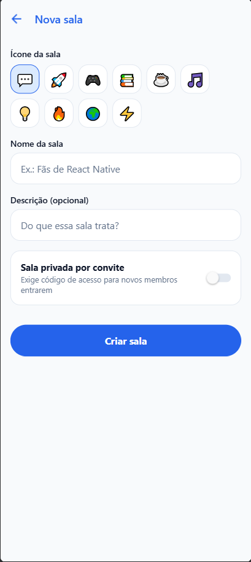

# 💬 ChatRoom

<p align="center">
  <strong>Aplicativo moderno de bate-papo em tempo real construído com React Native, Expo, Supabase e TypeScript estrito.</strong>
</p>

<p align="center">
  
  
  
  
  
  
  
</p>

---

## 📱 Demonstração Visual da Aplicação

<div align="center">
  <table>
    <tr>
      <td align="center" width="33%">
        <strong>Autenticação Segura</strong><br/><br/>
        
      </td>
      <td align="center" width="33%">
        <strong>Salas & Mensagens Diretas</strong><br/><br/>
        
      </td>
      <td align="center" width="33%">
        <strong>Criação & Salas Privadas</strong><br/><br/>
        
      </td>
    </tr>
  </table>
</div>

---

## 🚀 Principais Funcionalidades

### 1. Mensagens em Tempo Real & Atualizações Reativas
- **Salas Públicas e Temáticas:** Salas com ícones personalizados, tópicos de discussão e contagem de participantes em tempo real.
- **Mensagens Diretas 1 para 1 (DMs):** Canal privado entre dois usuários, isolado estritamente por políticas de segurança RLS (Row Level Security).
- **Indicador de Presença Online:** Exibição instantânea de quem está ativo na sala utilizando o Supabase Realtime Presence.
- **Indicador de Digitação em Tempo Real:** Feedback visual ao vivo de outros membros redigindo mensagens via canais de Broadcast.

### 2. Recursos de Mensageria Avançada (Apêndice C)
- ✏️ **Edição de Mensagens:** Edição de mensagens enviadas com atualização otimista na interface e indicador visual discreto `(editado)`.
- 🔒 **Salas Privadas por Convite:** Proteção por código de acesso personalizado. Novos membros só ingressam mediante validação correta do token.
- ❤️ **Reações Rápidas com Emojis:** Agrupamento e contagem em tempo real de reações (`❤️`, `👍`, `😂`, `🔥`, `🎉`).
- 📷 **Envio de Imagens e Mídia:** Upload para o Supabase Storage e renderização otimizada com miniaturas integradas na caixa de envio.
- ✓✓ **Confirmação de Leitura ("Visto por"):** Registro de leitura de mensagens e indicador de visto por membros da sala.
- 🔍 **Busca Textual Integrada:** Filtragem instantânea insensível a acentuação e caixa alta/baixa no corpo das mensagens e nomes de autores.
- 🔔 **Notificações Push com Edge Functions:** Disparo de notificações móveis via Expo Push API acionadas por gatilhos de banco de dados e Edge Functions em Deno.

---

## 🛠️ Tecnologias Utilizadas

| Camada | Ferramenta / Biblioteca | Descrição |
|---|---|---|
| **Linguagem & Tipagem** | [TypeScript](https://www.typescriptlang.org/) | Tipagem 100% estrita sem erros de compilação. |
| **Framework Mobile/Web**| [React Native](https://reactnative.dev/) / [Expo SDK 52](https://expo.dev/) | Desenvolvimento universal para iOS, Android e Web. |
| **Roteamento** | [Expo Router v4](https://docs.expo.dev/router/introduction/) | Roteamento baseado em arquivos com layouts aninhados e guards de autenticação. |
| **Backend & Banco de Dados** | [Supabase](https://supabase.com/) (PostgreSQL 15) | Auth, Storage, Realtime (Postgres Changes, Presence e Broadcast). |
| **Segurança no Banco** | [Row Level Security (RLS)](https://supabase.com/docs/guides/auth/row-level-security) | Políticas granulares de leitura, escrita e procedures `security definer`. |
| **Gerenciamento de Estado** | [TanStack React Query v5](https://tanstack.com/query/latest) | Cache inteligente, mutações otimistas e sincronização com Realtime. |
| **Formulários & Validação** | [React Hook Form](https://react-hook-form.com/) + [Zod](https://zod.dev/) | Validação de formulários de autenticação e criação de salas. |
| **Testes Automatizados** | [Jest](https://jestjs.io/) & [RNTL](https://callstack.github.io/react-native-testing-library/) | Testes unitários puros e testes assíncronos de componentes de interface. |
| **Testes de Banco Local** | [@electric-sql/pglite](https://pglite.electric-sql.com/) | Banco PostgreSQL WASM real executado em memória pelo Node test runner nativo. |
| **Integração Contínua** | [GitHub Actions](https://github.com/features/actions) | Pipeline de CI automatizada executando testes e typecheck a cada commit. |

---

## 📂 Estrutura do Projeto

```text
ChatRoom_App/
├── chatroom/                           # Projeto React Native / Expo
│   ├── app/                            # Rotas do Expo Router
│   │   ├── _layout.tsx                 # Root layout com providers e estilos globais web
│   │   ├── (auth)/                     # Rotas públicas de autenticação (Login, Cadastro)
│   │   └── (app)/                      # Rotas autenticadas
│   │       ├── _layout.tsx             # Proteção de rotas com AuthContext
│   │       ├── (tabs)/                 # Abas principais (Salas Públicas/DMs e Perfil)
│   │       └── room/                   # Telas de Sala ([id].tsx) e Nova Sala (new.tsx)
│   ├── src/
│   │   ├── components/                 # Componentes reutilizáveis (Button, Avatar, MessageBubble...)
│   │   ├── context/                    # Contextos globais (AuthContext)
│   │   ├── hooks/                      # Hooks de dados e Realtime (useMessages, useRooms, usePresence...)
│   │   ├── services/                   # Serviços de comunicação com o Supabase
│   │   ├── theme/                      # Paleta de cores, tipografia e espaçamentos
│   │   ├── types/                      # Definições de interfaces TypeScript centrais
│   │   └── utils/                      # Funções puras (agrupamento, busca, reações, formatação)
│   ├── __tests__/                      # 38 testes de funções puras e componentes RNTL
│   ├── supabase/
│   │   ├── schema.sql                  # Schema completo DDL, políticas RLS, gatilhos e funções
│   │   ├── functions/                  # Supabase Edge Functions (notificações push)
│   │   └── tests/                      # 19 testes de banco de dados executados com PGlite
│   └── package.json
├── docs/screenshots/                   # Imagens e capturas de tela da aplicação
├── relatório/                          # Relatórios minuciosos de auditoria e evolução
│   ├── relatorio_erros.md              # Relatório completo dos 9 erros encontrados e resolvidos
│   └── implementações extras.md        # Documentação completa dos 10 desafios do Apêndice C
└── .github/workflows/test.yml          # Pipeline de Integração Contínua (CI)
```

---

## ⚙️ Instalação e Execução

### Pré-requisitos
- **Node.js** v20 ou superior (recomendado v22)
- **pnpm** instalado globalmente (`npm install -g pnpm`)

### 1. Clonar o repositório
```bash
git clone https://github.com/<seu-usuario>/ChatRoom_App.git
cd ChatRoom_App/chatroom
```

### 2. Instalar as dependências
```bash
pnpm install
```

### 3. Configurar variáveis de ambiente
Crie o arquivo `.env` dentro da pasta `chatroom/`:
```env
EXPO_PUBLIC_SUPABASE_URL=https://<seu-projeto>.supabase.co
EXPO_PUBLIC_SUPABASE_ANON_KEY=<sua-anon-key>
```

### 4. Configurar o banco de dados no Supabase
1. Acesse o seu painel do Supabase em [supabase.com](https://supabase.com).
2. Abra o **SQL Editor**.
3. Copie o conteúdo completo do arquivo [`chatroom/supabase/schema.sql`](./chatroom/supabase/schema.sql) e execute.
   *O script cria todas as tabelas, índices, funções de segurança, políticas RLS e publicações Realtime necessárias.*

### 5. Iniciar o aplicativo
```bash
# Inicia o servidor Expo
pnpm dev

# Pressione:
# 'w' para abrir no navegador web
# 'a' para abrir no emulador Android
# ou escaneie o QR Code no aplicativo Expo Go no seu celular
```

---

## 🧪 Testes Automatizados e Qualidade

O projeto conta com **57 testes automatizados** integrados e verificação estrita de TypeScript.

```bash
# Executa todos os testes (App Jest + Banco de dados PGlite)
pnpm test

# Executa apenas os testes unitários e de componentes do app
pnpm run test:app

# Executa os testes de regras de banco de dados e RLS no PostgreSQL
pnpm run test:db

# Verificação estrita de tipos TypeScript (0 erros)
pnpm run typecheck

# Formatação de código com Prettier
pnpm run format
```

---

## 📋 Relatórios Técnicos

Dentro da pasta [`relatório/`](./relatório/) encontram-se documentos detalhados sobre o ciclo de desenvolvimento:

- 📝 [**Relatório de Erros e Soluções (`relatorio_erros.md`)**](./relatório/relatorio_erros.md): Diagnóstico exaustivo de 9 problemas técnicos encontrados durante o desenvolvimento e como foram corrigidos (incluindo incompatibilidades de ESM no Jest, tipagem de `ColorValue`, conflito HTTP 409 de foreign keys em `rooms`, auto-recuperação de perfis e Caret Browsing no navegador).
- 🏆 [**Relatório de Implementações Extras (`implementações extras.md`)**](./relatório/implementações%20extras.md): Detalhamento arquitetural, modelagem de tabelas, fluxos e evidências de validação de todos os 10 desafios do Apêndice C.

---

## Licença

Este projeto é desenvolvido para fins educacionais e de portfólio sob a licença [MIT](./LICENSE).
