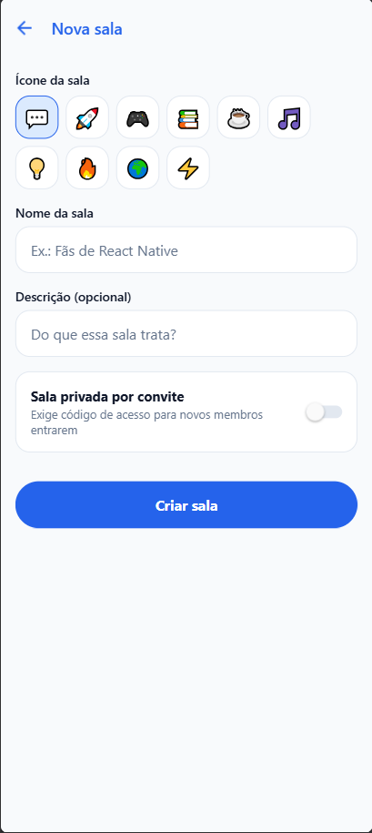

# ChatRoom

App de mensagens em tempo real para Android, iOS e Web. O usuario entra em salas publicas ou privadas, conversa com quem esta nelas, acompanha quem esta online e ve quem esta digitando em tempo real, sem necessidade de atualizar a tela manualmente.

## Telas do Aplicativo

| Login | Lista de Salas | Nova Sala |
| :---: | :---: | :---: |
|  |  |  |

## Funcionalidades

- Autenticacao com e-mail e senha (cadastro e login).
- Perfil automatico: criacao do perfil com nome e cor de avatar via trigger no banco de dados.
- Salas publicas e mensagens diretas (1 para 1): separacao entre salas abertas e conversas privadas com isolamento via Row Level Security (RLS).
- Mensagens em tempo real: sincronizacao instantanea via Supabase Realtime (postgres_changes).
- Envio otimista: a mensagem e renderizada imediatamente na interface e confirmada em segundo plano pelo servidor.
- Presenca: contador de usuarios online na sala em tempo real (Supabase Presence).
- Indicador de digitando: aviso efemero transmitido por canal de broadcast sem gravacao em tabela.
- Edicao e exclusao de mensagens: permissao restrita ao autor com indicador visual de mensagem editada.
- Reacoes em mensagens: adicao e remocao de reacoes por emoji com contagem agregada.
- Confirmacao de leitura: marcadores de entrega e visualizacao por outros membros da sala.
- Envio de imagens: upload de anexos para o Supabase Storage com pre-visualizacao.
- Salas privadas: controle de acesso por codigo de convite com validacao antes do ingresso.
- Busca de mensagens: filtro textual em tempo real no historico da sala.

## Tecnologias

- Frontend: React Native 0.88, Expo SDK 52, Expo Router v4, React Hook Form, Zod.
- Estado e Cache: TanStack React Query v5.
- Backend: Supabase (PostgreSQL 15, Auth, Storage, Realtime).
- Seguranca: Row Level Security (RLS) e funcoes PostgreSQL com security definer.
- Testes: Jest, React Native Testing Library e PGlite (PostgreSQL em memoria via WASM).
- CI: GitHub Actions rodando verificacao de tipos e testes a cada commit.

## Como Executar

### Pre-requisitos

- Node.js versao 22 ou superior
- pnpm (`npm install -g pnpm`)

### 1. Instalacao

```bash
pnpm install
```

### 2. Variaveis de Ambiente

Crie o arquivo `.env` dentro da pasta `chatroom/`:

```env
EXPO_PUBLIC_SUPABASE_URL=https://<seu-projeto>.supabase.co
EXPO_PUBLIC_SUPABASE_KEY=<sua-chave-anon-ou-publishable>
```

### 3. Banco de Dados

1. Acesse o painel do Supabase.
2. Abra o SQL Editor.
3. Execute o conteudo de `supabase/schema.sql`.
4. Em Database -> Replication, confirme que a tabela `messages` esta com publicacao ativa para o Realtime.

### 4. Executando o Projeto

```bash
# Iniciar o servidor de desenvolvimento
pnpm dev

# Abrir no navegador web: pressione 'w' no terminal
# Abrir no Android: pressione 'a' no terminal ou use o Expo Go
# Abrir no iOS: use o aplicativo Expo Go
```

## Testes Automatizados

O projeto conta com 57 testes automatizados cobrindo regras de negocio, funcoes puras, componentes de interface e politicas de banco de dados.

```bash
# Executa todos os testes (app e banco de dados)
pnpm test

# Executa apenas os testes do app (Jest e React Native Testing Library)
pnpm run test:app

# Executa os testes de politicas de seguranca e funcoes no PostgreSQL (PGlite)
pnpm run test:db

# Checagem estrita de tipos TypeScript
pnpm run typecheck

# Formatacao de codigo
pnpm run format
```

## Arquitetura

```
chatroom/
├── app/                  # Rotas e layouts do Expo Router
│   ├── (auth)/           # Rotas publicas (login, cadastro)
│   └── (app)/            # Rotas autenticadas (salas, perfil, nova sala)
├── src/
│   ├── components/       # Componentes reutilizaveis de UI
│   ├── context/          # Contexto global de autenticacao (AuthContext)
│   ├── hooks/            # Hooks de dados, presenca e tempo real
│   ├── services/         # Integracao com a API do Supabase
│   ├── theme/            # Cores, espacamentos e raios de borda
│   ├── types/            # Tipagens centrais TypeScript
│   └── utils/            # Funcoes puras testadas unitariamente
├── __tests__/            # Testes unitarios e de componentes
├── supabase/
│   ├── schema.sql        # Definicao DDL, RLS, triggers e funcoes do banco
│   ├── functions/        # Edge Functions (notificacoes push)
│   └── tests/            # Testes de banco executados com PGlite
├── docs/screenshots/     # Capturas de tela da aplicacao
└── relatorio/            # Relatorios tecnicos do projeto
```

## Relatorios

- `relatorio/relatorio_erros.md`: Documentacao detalhada de todos os erros diagnosticados no desenvolvimento e suas respectivas solucoes tecnicas.
- `relatorio/implementacoes_extras.md`: Documentacao tecnica dos 10 desafios de evolucao concluidos do Apendice C.
